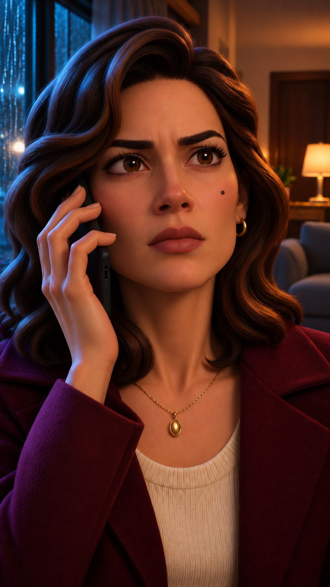

# E01 · C01 — A ligação impossível

Quadro inicial de produção do roteiro candidato. Vídeo ainda em teste. A Clara escuta a voz de Helena. A atuação cresce de tensão a reconhecimento, medo e choro. O quadro salvo começa com o rosto seco para a lágrima nascer e correr no vídeo.



## Flow

Use o PNG como quadro inicial em Frames para vídeo, formato 9:16, 8 segundos se disponíveis. Ajuste o corte para cerca de 7 segundos na montagem.

```text
Vídeo vertical 9:16, 8 s, plano único. Use o quadro inicial. Clara, 31, pele oliva clara, olhos castanhos, sobrancelhas grossas, ondas castanho-escuras, pinta na bochecha esquerda dela. Casaco vinho, blusa creme canelada, argolas e pingente oval dourados. Na sala 704, janela chuvosa azul à esquerda da tela, abajur âmbar e porta fechada à direita. Celular preto na mão e no ouvido direitos dela. 0–2 s: escuta alerta e prende o ar. 2–4 s: reconhece a voz, arregala os olhos e aperta o celular. 4–7 s: os ombros encolhem, o queixo treme e uma lágrima escorre pela bochecha direita dela. 7–8 s: sustente o olhar em choque. Close com avanço mínimo, 3D adulto cinematográfico. Só Clara em quadro, lábios fechados. Chuva baixa e respiração falha. Sem falas, batidas, música ou texto. Preserve rosto, mão, roupa e cenário.
```

## YouTube Create

Em Gerar vídeo, adicione o PNG como referência e selecione 9:16.

```text
9:16. Anime a imagem de Clara em close 3D adulto cinematográfico. Preserve seu rosto oliva, olhos castanhos, sobrancelhas marcadas, ondas escuras, pinta na bochecha esquerda dela, casaco vinho, blusa creme, argolas e pingente oval dourados. Celular preto na mão e no ouvido direitos dela. Sala 704 fixa, chuva azul à esquerda da tela, abajur âmbar e porta fechada à direita. Escuta tensa, prende o ar. Em seguida reconhece a voz, os olhos se arregalam e os dedos apertam o celular. No ápice, os ombros encolhem, o queixo treme e uma lágrima escorre pela bochecha direita dela. Termine com seu olhar paralisado. Plano único, câmera quase parada. Só Clara em quadro, lábios fechados. Som baixo de chuva e respiração. Sem falas, batidas, música ou texto.
```

## Montagem e continuidade

Insira por volta de 1 s a fala de Helena em faixa separada, com voz adulta feminina PT-BR nativa, afetuosa, urgente e abafada pelo telefone: **“Clara... não abre essa porta.”**. Clara fica em silêncio nesta tomada. “Mãe?” abre a C02 conforme o storyboard. As batidas ficam na C03.

Encerre com o telefone no ouvido direito anatômico e a lágrima na bochecha direita anatômica. Guarde o último quadro válido para abrir a C02. Confira mão e contato com o celular, movimento da lágrima, silêncio labial, porta fechada, rosto e figurino antes de avançar.
